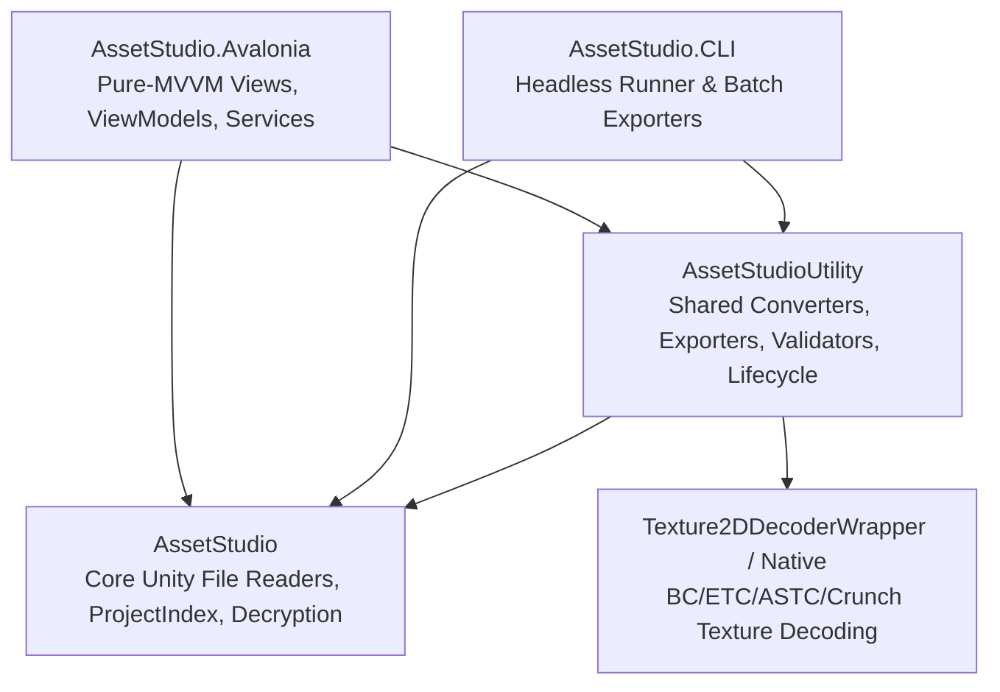

# AssetStudio Architecture Map

This document describes the module boundaries, shared GUI/CLI pipelines, lifecycle and disposal contracts, and core pipeline partitions across the AssetStudio solution.

## Solution Layer Boundaries

Dependencies flow strictly downward from hosts to shared conversion utilities and core Unity readers:

### Layer Responsibilities

1. **`AssetStudio` (Core Reader & Index Layer)**
   - Binary Unity parsers (`AssetsManager`, `SerializedFile`, `BundleFile`, `WebFile`, `ResourceReader`, `TypeTreeHelper`).
   - Lazy indexing and arena storage (`ProjectIndex`, `AssetIndexArena`, `AssetHandle`, `ProjectScanner`).
   - Disk decompression caching (`DecompressedBundleCache`), stream ownership (`SharedFileHandle`, `SubStream`), Addressables catalog resolution (`AddressablesCatalogDependencyResolver`), and decryption infrastructure.
   - Zero UI dependencies.

2. **`AssetStudioUtility` (Shared Conversion, Export, Validation & Lifecycle Layer)**
   - Reusable across **both** `AssetStudio.Avalonia` and `AssetStudio.CLI`, with zero UI framework imports.
   - Intermediate 3D graph conversion (`ModelConverter` partials, `TerrainMeshConverter`, `HumanoidMuscleDecoder`).
   - Exporters and validators (`GltfExporter` partials, `Gltf2Validator`, `FbxSharpieExporter`, `ModelExporter`, `AssetExportHelper`, `Texture2DConverter`, `Texture2DArrayConverter`, `TextureMipmapService`, `HdrTextureExporter`, `AudioClipConverter`, `UnityAudioDecoder`, `Fsb5VorbisReconstructor`, `SpriteHelper`, `SpriteAtlasMetadataExporter`, `ShaderConverter`, `MonoBehaviourConverter`).
   - Shared structured reporting and lifecycle contracts (`ExportReport`, `ExportOutcomeStatus`, `ExportDiagnostic`, `OperationLifecycle`).

3. **`AssetStudio.CLI` (Headless Host)**
   - Command-line runner (`CliRunner`, `CliAssetExporter`, `CliCaching`, `CliDecryption`, `CliKeyCapture`) consuming `AssetStudio` and `AssetStudioUtility` directly.
   - Emits deterministic structured `ExportReport` JSON artifacts with explicit `Completed`, `Partial`, `Failed`, and `Cancelled` outcomes.

4. **`AssetStudio.Avalonia` (Desktop GUI Host — Pure MVVM)**
   - **`Services/`**: Pure, UI-independent services with **zero `using Avalonia`** imports (except `AvaloniaDialogService`, which implements `IDialogService` as the thin UI dialog adapter). Includes project loading, lazy asset resolution, semantic graph indexing, Unity project/package export, scene GLB export, shader/video/audio preview services, and session/preview lifecycle coordinators.
   - **`ViewModels/`**: Headlessly testable ViewModels (`MainWindowViewModel`, `ProjectSessionViewModel`, `PreviewSessionViewModel`, `AssetListViewModel`, `SceneHierarchyViewModel`, `MeshPreviewViewModel`, `ExportViewModel`, `IndexingProgressViewModel`, `MediaPlaybackViewModel`, `WindowOptionsViewModel`) with **zero `using Avalonia`** imports.
   - **`Views/` & `MainWindow.*.cs`**: Avalonia AXAML views using compiled bindings (`x:CompileBindings="True"`, zero `Click=` handlers) and thin code-behind partials delegating domain orchestration and lifecycle control to ViewModels and Services.

---

## Shared Lifecycle, Cancellation & Resource Ownership Contracts

Shared primitives live in `AssetStudioUtility/OperationLifecycle.cs` so GUI and CLI operations share uniform progress, outcome, cancellation, and disposal semantics:

| Type | Location | Contract |
| --- | --- | --- |
| `OperationProgressSnapshot` | `AssetStudioUtility/OperationLifecycle.cs` | Immutable progress value (`Completed`, `Total`, `Percent`, `Stage`, `Detail`, `ElapsedMs`) with clamped percentage calculation. |
| `IOperationProgressSink` | `AssetStudioUtility/OperationLifecycle.cs` | UI-free progress callback abstraction with `NullOperationProgressSink` and `DelegateOperationProgressSink`. |
| `OperationExecutionResult<T>` | `AssetStudioUtility/OperationLifecycle.cs` | Structured execution outcome explicitly distinguishing `ExportOutcomeStatus` (`Completed`, `Partial`, `Failed`, `Cancelled`), optional `Value`, `Diagnostics`, `Summary`, and `ElapsedMs`. |
| `OwnedResourceScope` | `AssetStudioUtility/OperationLifecycle.cs` | Thread-safe deterministic ownership container for streams, file handles, native wrappers, `IDisposable` objects, and cleanup callbacks. Disposes in strict LIFO order, is idempotent, never holds locks during `Dispose()`, and captures disposal errors without masking primary exceptions or leaking remaining handles. |
| `GenerationCancellationGate` | `AssetStudioUtility/OperationLifecycle.cs` | Thread-safe generation-numbered cancellation gate. `BeginNext(out long generation)` atomically advances the generation and cancels/disposes the prior `CancellationTokenSource` outside the lock; `IsCurrent(long)` rejects stale work; `CancelAll()` and `Dispose()` cleanly release active tokens. |

### Decoupled MainWindow Coordinators

Two pure, Avalonia-free services in `AssetStudio.Avalonia/Services/` coordinate stateful transitions without requiring a `MainWindow` instance:

- **`ProjectSessionCoordinatorService`** (`AssetStudio.Avalonia/Services/ProjectSessionCoordinatorService.cs`)
  - Owns the active project session's `GenerationCancellationGate` and per-session `OwnedResourceScope`.
  - Rapid project switches, form resets, navigation back to Project Manager, and window shutdown cancel prior session tokens immediately and dispose all resources owned by the superseded session deterministically.
  - Exposes `RunSessionLoadAsync<T>` for headless execution with structured progress snapshots and `OperationExecutionResult<T>` outcomes (`Completed`, `Cancelled`, `Failed`), tearing down partially acquired resources automatically on cancellation or failure.

- **`PreviewResolutionCoordinatorService`** (`AssetStudio.Avalonia/Services/PreviewResolutionCoordinatorService.cs`)
  - Owns the preview resolution `GenerationCancellationGate` and active preview `OwnedResourceScope`.
  - Rapid asset selection changes cancel in-flight debouncing/resolution work immediately and dispose superseded preview resources as soon as a newer selection arrives or the preview is cleared.
  - Wired into `MainWindow.PreviewRouting.cs` (replacing manual debounce CTS fields) and `MainWindow.WindowSettings.cs` / `MainWindow.axaml.cs` teardown paths.
  - `AsyncPreviewRequestCoordinator` delegates directly to `GenerationCancellationGate`, eliminating duplicated CTS/lock management across preview, dump, references, inspector, and script tabs.

---

## Core Pipeline Modularization Map

Large conversion, export, and graph-indexing engines are split into cohesive `partial class` modules along clear domain boundaries while preserving identical public/internal APIs:

### 1. `GltfExporter` (`AssetStudioUtility`)
Pure-C# glTF 2.0 / GLB v2 exporter consuming `IImported`:

| File | Responsibility |
| --- | --- |
| `GltfExporter.cs` | `GltfExportStatistics`, exporter state, `Export()` pipeline entry, node hierarchy & coordinate transforms, math and filename sanitization helpers. |
| `GltfExporter.Materials.cs` | PBR metallic-roughness material conversion, texture lookup/deduplication, and SkiaSharp channel packing (metallic/roughness/occlusion/normal/baseColor). |
| `GltfExporter.Meshes.cs` | Mesh geometry, instancing/shared geometry deduplication, skinning/skeleton grouping, and morph target (blend shape) generation. |
| `GltfExporter.Animations.cs` | Keyframed TRS tracks, shortest-arc quaternion normalization, and combined morph weight animation channels. |
| `GltfExporter.Serialization.cs` | JSON serialization (`Utf8JsonWriter`), KHR extension emission, separate `.gltf` + `.bin` writer, and binary GLB v2 container writer. |
| `GltfExporter.Buffers.cs` | Vertex color accessor helpers, internal glTF model records, and binary `BufferBuilder` (buffer views & accessors). |

### 2. `ModelConverter` (`AssetStudioUtility`)
Unity asset-to-`IImported` intermediate graph builder:

| File | Responsibility |
| --- | --- |
| `ModelConverter.cs` | Conversion options/types (`SceneConversionOptions`, `LodGroupExclusionResult`), scene & hierarchy conversion, LOD group filtering, renderer/mesh conversion, terrain conversion, cameras/lights, and model-group/mesh factories. |
| `ModelConverter.Materials.cs` | Material conversion (`ConvertMaterial`), parsed shader/keyword/tag inspection, auxiliary/shadow-only renderer visibility heuristics, and texture resolution & slot priority mapping. |
| `ModelConverter.Animations.cs` | AnimationClip conversion, streamed/dense/constant curve decoding, bone path CRC hashing, optimized transform hierarchy reconstruction, avatar matching, and humanoid muscle decoding. |
| `ModelConverter.MeshCombining.cs` | Multi-mesh combining (`CombineMeshes`, `CreateCombinedView`), combined morph merging, blendshape track remapping, and relative frame/matrix math. |

### 3. `UnityProjectExporterService` (`AssetStudio.Avalonia/Services`)
Openable Unity project (`.unity`, `.prefab`, `.mat`, `.fbx`, `.png`, `.meta`, `ProjectSettings`, manifest) exporter:

| File | Responsibility |
| --- | --- |
| `UnityProjectExporterService.cs` | Export options, statistics, manifest & result models, deterministic GUID delegation, main scene/prefab entrypoints, Pass 1 scene graph collection, Pass 2 binary/asset writers (ProjectSettings, textures, meshes, materials, terrains), manifest & unified `ExportReport` building, and asset resolution helpers. |
| `UnityProjectExporterService.Yaml.cs` | Streaming Unity YAML 1.1 scene and prefab writers, component YAML emitters, incremental MonoBehaviour TypeTree YAML serializer with depth/collection/byte-array bounds and truncation diagnostics, path confinement checks, and YAML scalar/dictionary conversion helpers. |

### 4. `SemanticGraphService` (`AssetStudio.Avalonia/Services`)
Cross-file asset relationship discovery and lazy SQLite connection staging:

| File | Responsibility |
| --- | --- |
| `SemanticGraphService.cs` | Core reference index orchestration, cross-file `PPtr` semantic origin resolution, model-group discovery and assembly, lazy connection pass & batched SQLite staging, and internal lookup/binding types. |
| `SemanticGraphService.Materials.cs` | Renderer-to-material slot bindings, material texture slot scoring/selection, preview material matching, and container-based material heuristics. |
| `SemanticGraphService.Animations.cs` | Animator/Avatar/Mesh/AnimationClip relationship extraction, rig & clip bone hash indexing, and animation candidate resolution. |
